# Pixel Perfect

**Your frontend quality agent.** My coding agents write the UI. Pixel Perfect proves it's right, and fixes it when it isn't.

[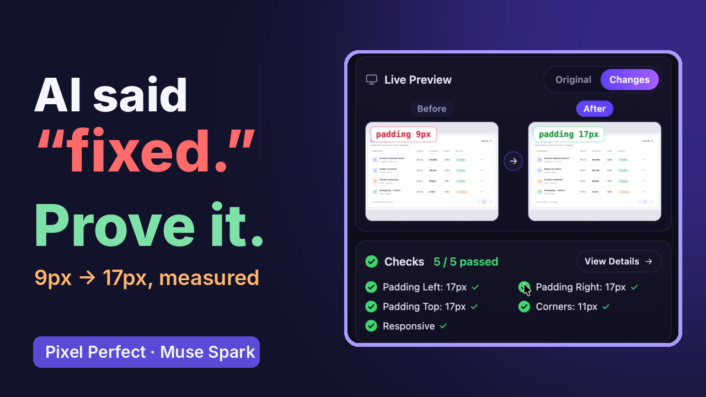](VIDEO_LINK)

▶️ **[Watch the 3-minute demo](VIDEO_LINK)**

Pixel Perfect is a Chrome side-panel agent powered by **Muse Spark** through the Meta Model API. Select what looks wrong on your running app and describe it in plain English. Pixel Perfect investigates the live page, finds the root cause, previews a fix, edits your source code, and proves the result with measurements at mobile, tablet and desktop widths.

<p align="center">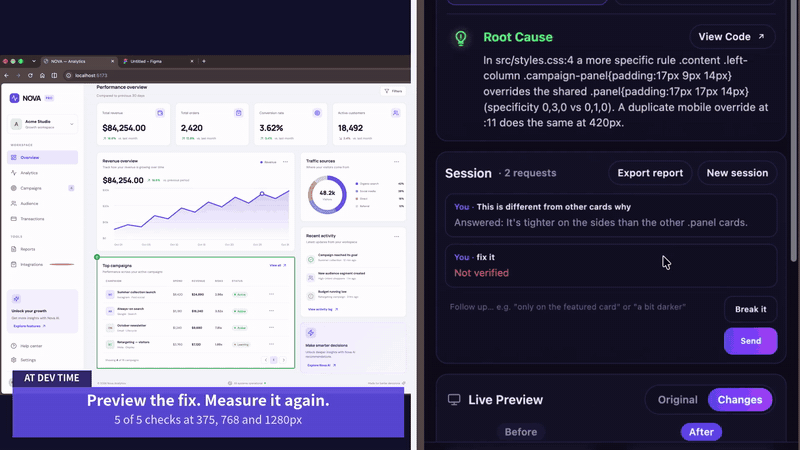</p>

## Why

AI coding agents can build entire interfaces, but getting the code written isn't the same as getting the interface right. In the [Stack Overflow 2025 Developer Survey](https://survey.stackoverflow.co/2025/), 84% of developers use or plan to use AI tools, only 33% trust its accuracy, and 66% name "AI solutions that are almost right, but not quite" as their top frustration.

In UI, "almost right" means 9px padding instead of 17px, a card that breaks with a long name, or a button a keyboard can't reach. Finding these still means opening the browser, inspecting CSS, finding what's broken, going back to the agent, and repeating. I built Pixel Perfect to close that loop.

## Features

### Fix: inspect → explain → fix → verify
1. **Root cause.** Pick an element (Shift+click for several, ↑ for the whole block), describe the problem, and Pixel Perfect names the CSS rule that wins, with its file and line.
2. **Live preview.** The fix is applied on the page first, with a Before/After view and an Original/Changes toggle.
3. **Verified with numbers.** Checks are measured on the page: CSS values, centered, size, spacing, aligned, visible, no overflow, contrast and line count.
4. **Responsive.** The fix is re-measured at 375, 768 and 1280px.
5. **Apply and re-check.** The local bridge writes the source edit, then Pixel Perfect re-runs the same checks on the real code. Open in VS Code, or undo.
6. **Copy CSS.** For pages where Pixel Perfect can't write code.

<table>
<tr>
<td width="50%">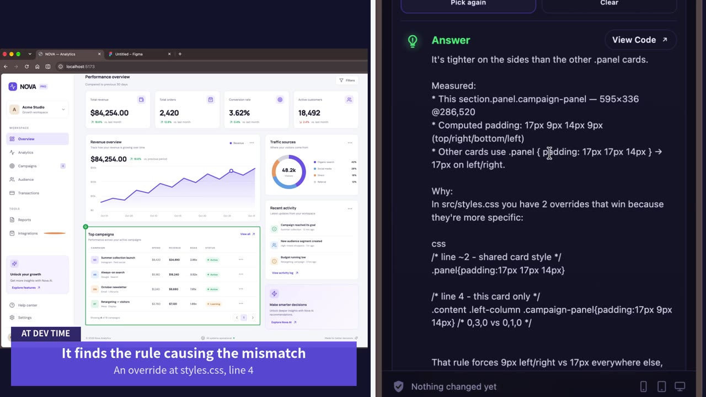<br><b>Root cause:</b> the override at <code>styles.css</code>, line 4</td>
<td width="50%">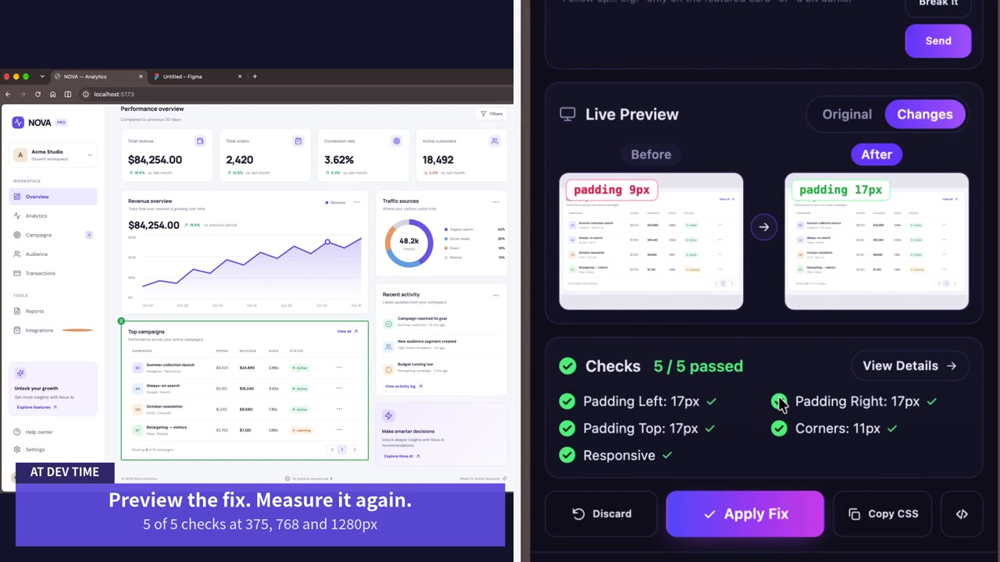<br><b>Preview, then measure:</b> 5 of 5 checks at 375, 768 and 1280px</td>
</tr>
<tr>
<td>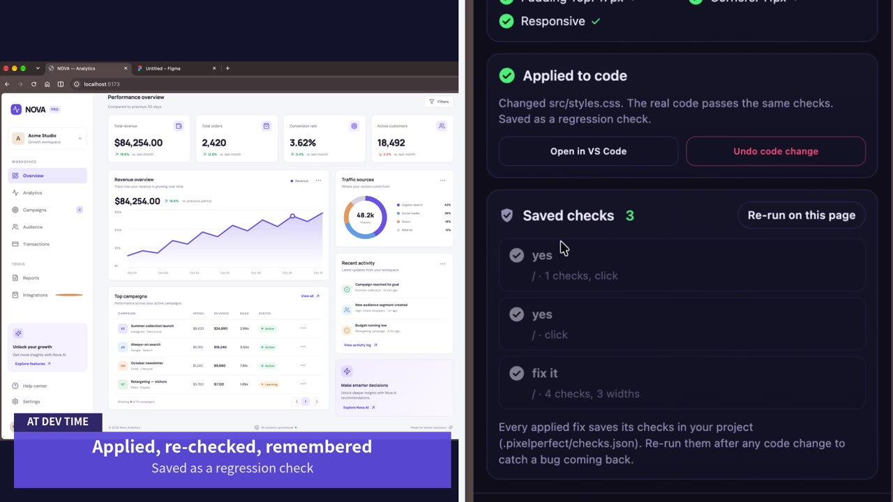<br><b>Applied and re-checked</b> on the real code, then saved as a regression check</td>
<td>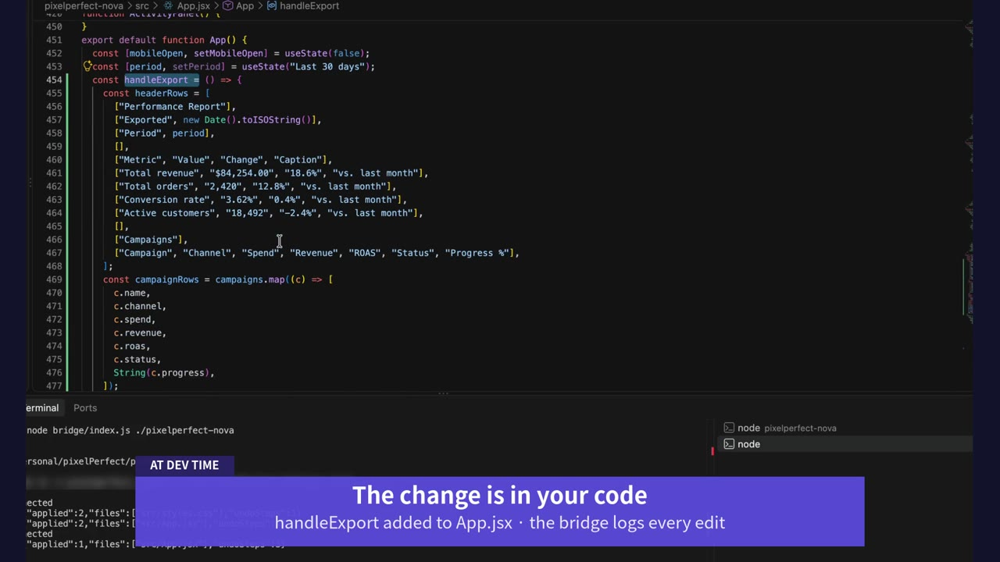<br><b>The change is in your code,</b> and every edit can be undone</td>
</tr>
</table>

### Test: beyond the happy path
7. **Figma match.** Finds the matching frame in your Figma file and turns its values into acceptance checks.
8. **Break it.** Attacks the selected block with long text, long words, huge numbers, empty data, many items, big font, narrow screens and right-to-left. It reports what broke, by how many pixels, and which rule causes it.
9. **Interaction states.** Forces hover, focus and active through the Chrome debugger and toggles disabled. It also finds elements that look clickable but can't be reached by keyboard, and buttons with no accessible name.
10. **Click and watch.** Clicks a button and reports what happened: DOM changes, errors, network calls, or nothing. Risky clicks (delete, pay, send, log out…) are refused.
11. **Page errors.** Console errors, failed requests and unhandled rejections, including those from before the panel was opened, with the file and line in your own code.
12. **Approval for behaviour.** Before adding new behaviour, such as a click handler, it asks you first. After Apply, it clicks again to confirm.

<table>
<tr>
<td width="50%">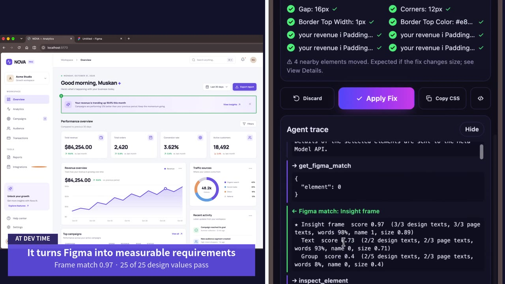<br><b>Figma match:</b> frame score 0.97, 25 of 25 design values pass</td>
<td width="50%">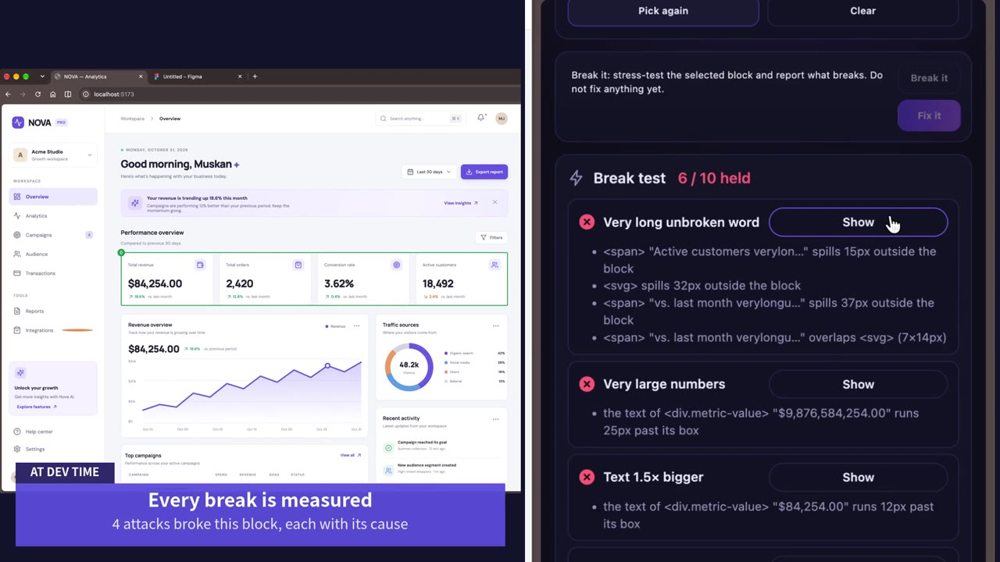<br><b>Break it:</b> 4 attacks broke this block, each measured with its cause</td>
</tr>
<tr>
<td>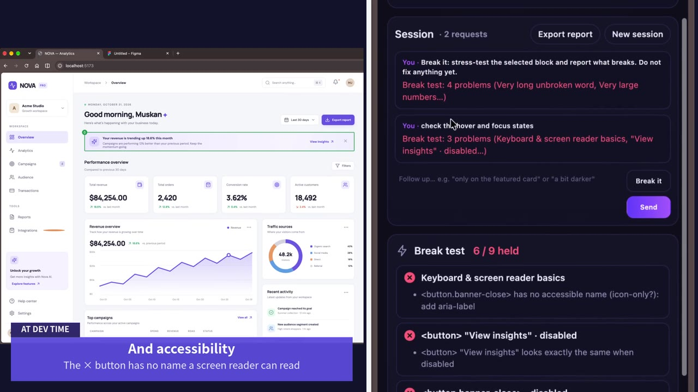<br><b>States:</b> the × button has no name a screen reader can read</td>
<td>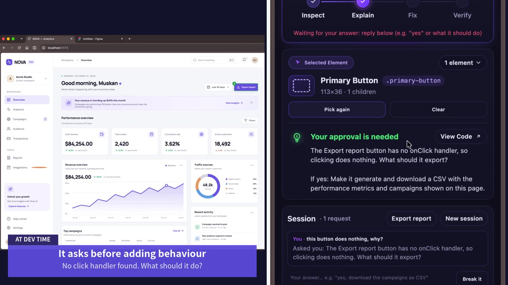<br><b>Approval first:</b> no click handler found, so it asks what the button should do</td>
</tr>
<tr>
<td>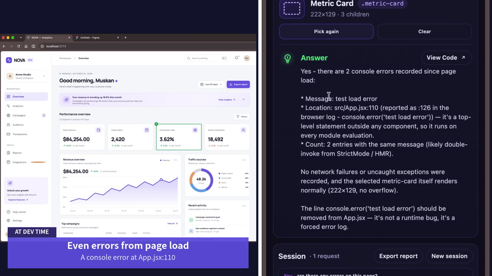<br><b>Questions get answers:</b> a console error from page load, nothing changed</td>
<td>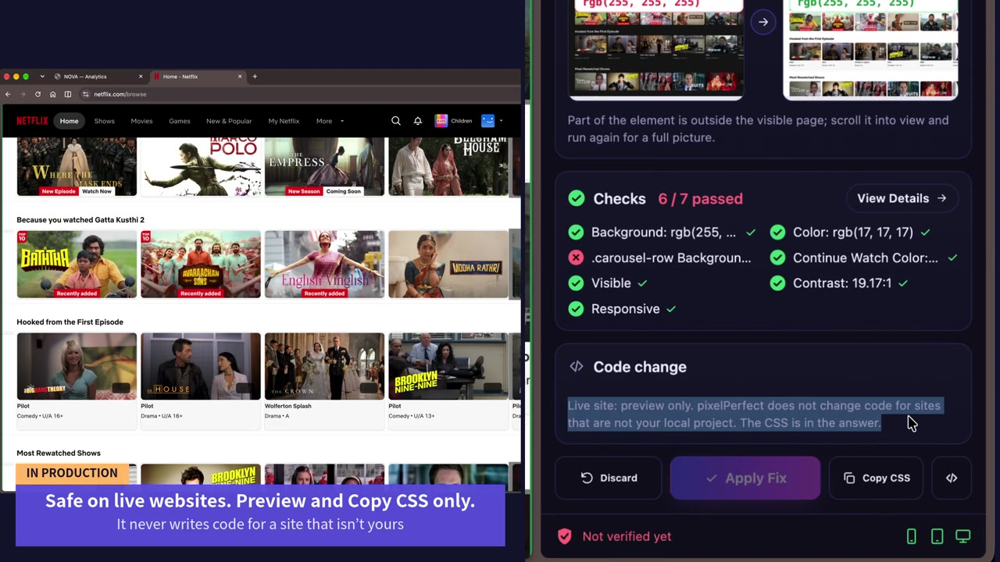<br><b>In production:</b> preview and Copy CSS only on sites that aren't yours</td>
</tr>
</table>

### Trust: guardrails enforced in code
13. **Live-site guard.** On sites that aren't your local project, it previews only and never writes code.
14. **No hacks.** Refuses `!important`, generated class names, and fixes that hide the problem (`overflow:hidden`, fixed heights, ellipsis). Acceptance checks are locked, so the agent can't loosen a failing check to pass. If everything already passes, it changes nothing.
15. **Flags contradictions.** "3px text that is readable" gets a NOTE instead of a silent guess.
16. **Questions get answers.** "Are there errors on this page?" gets an answer, not a change. Results are always reported as Verified, Failed or NOT TESTED.

### Remember: beyond one session
17. **Sessions.** Follow-ups keep context ("only on this card", "a bit darker"). Sessions are saved per page and resume when you return.
18. **Shareable report.** A markdown report with the request, cause, checks (expected vs measured), widths, break tests, behaviour and diff, saved to `.pixelperfect/reports/`.
19. **Regression checks.** Every verified Apply saves its checks to `.pixelperfect/checks.json`. **Re-run on this page** flags anything that has come back as **REGRESSED**, with the numbers.

<p align="center">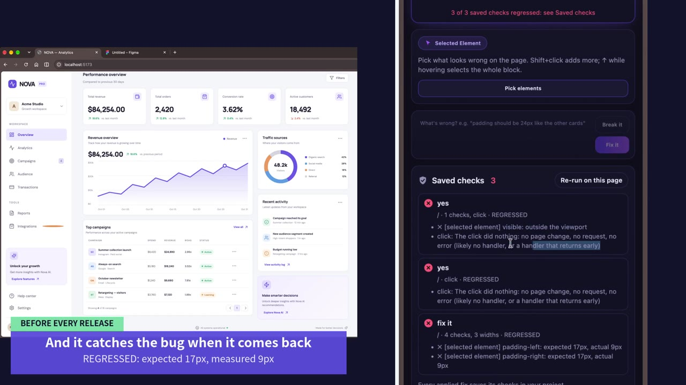<br><b>The bug came back,</b> and one click caught it: expected 17px, measured 9px</p>

## Quick start

You need Node 18+ and Chrome.

```bash
# 1. Install the bridge (first time only)
cd bridge && npm install && cd ..

# 2. Start your app's dev server (in its own terminal)
cd /path/to/your/project && npm run dev        # e.g. http://localhost:5173

# 3. Start the bridge for that project (in another terminal)
node bridge/index.js /path/to/your/project
```

The bridge prints a pairing token and saves it in `~/.pixelperfect/bridge-token`, so it stays the same every time.

4. In Chrome, open `chrome://extensions`, turn on **Developer mode**, click **Load unpacked**, and choose the `extension/` folder.
5. Open the Pixel Perfect side panel, then **Settings**:
   - **Meta API key, model and base URL** for Muse Spark.
   - **Bridge token** (first time only).
   - Optional: a **Figma link and personal access token**, then **Load design**.
   - Click **Save**, then **Test current mode**.
6. Open your app, click **Pick elements**, pick what looks wrong, and describe it.

<table>
<tr>
<td width="50%">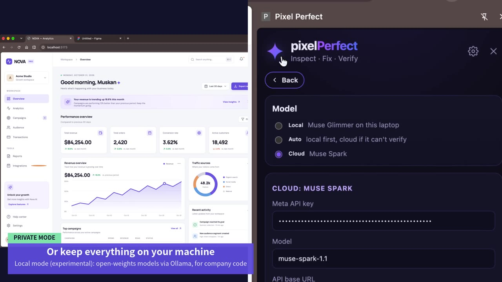<br><b>Settings:</b> Muse Spark (cloud), or local mode for open-weights models</td>
<td width="50%">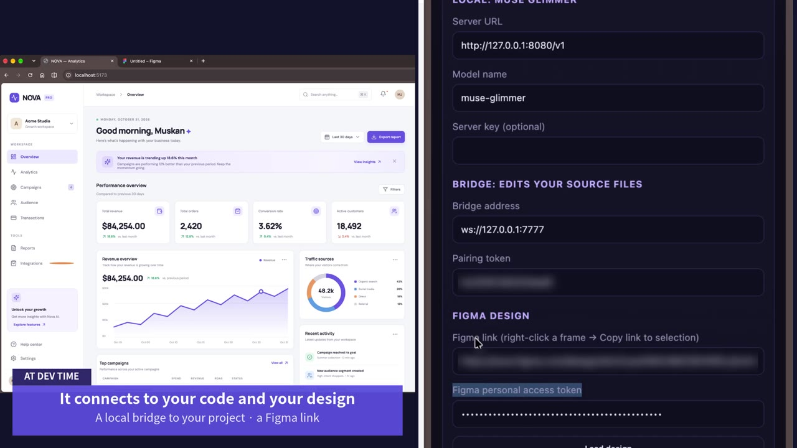<br><b>Bridge and Figma:</b> pair the bridge once, add a Figma link</td>
</tr>
</table>

To try it without your own project, a demo shop with planted bugs is included:

```bash
cd demo-app && npm install && npm run dev
node bridge/index.js ./demo-app
```

The bug list is in `demo-app/BUGS.md`, which the bridge never opens, so the agent can't read the answers. The demo video uses NOVA, a separate React + Vite dashboard with 7 planted bugs.

**Tips**
- Run your app on its **dev server**. A production build hides source files behind hashed bundles.
- After replacing extension files, click **Reload** on Pixel Perfect in `chrome://extensions` and reload the tab. If the panel shows a red bar, it's running old files.
- Optional, Vite + React only: `ppSourceBabel` (in `vite-plugin/`) tags each element with its exact file and line in dev builds. It isn't needed, because Pixel Perfect also finds sources through stylesheet paths, React component locations and search.

## Using it

| You want to… | Do this |
|---|---|
| Fix something | Pick it, describe it ("padding should match the other cards"), review the preview and checks, then **Apply Fix** |
| Match the design | Load a Figma design in Settings, pick the element, ask "match the design" |
| Stress-test a block | Pick it and click **Break it** |
| Check hover and focus | Ask "check the hover and focus states" |
| Debug a button | Ask "this button does nothing, why?" |
| Ask a question | Ask it ("are there errors on this page?"). You get an answer, not a change |
| Share the result | **Export report** in the Session header |
| Catch regressions | After code changes, click **Re-run on this page** under Saved checks |

## What "verified" means

The checks listed in the result passed, at the screen widths and states listed, on the page state that was tested. It does not prove the whole app is correct. Other pages, states and browsers are not covered, and Pixel Perfect lists what it did not test.

## How it works

```
 Your page  ⇄  Side panel agent  ⇄  Local bridge  ⇄  Your source files
 (measure,     (Muse Spark picks     (127.0.0.1, token,    (.pixelperfect/
  preview,      the next tool;        project folder only)   checks, reports)
  stress)       guardrails in code)
```

1. **Muse Spark** reasons and picks the next tool call (OpenAI-style tool calling).
2. **Browser tools** gather evidence: computed styles, the CSS rules that win and their source files, React components, measurements, stress results and console errors. The Chrome debugger sets screen widths and forces hover and focus.
3. The **agent loop** runs each tool, sends back the result, and enforces the rules: locked checks, approval for behaviour, the live-site guard, and no change when the checks already pass.
4. The **bridge** finds, reads and edits source files in your project, and saves checks and reports.

| Part | File | Job |
|---|---|---|
| Agent loop | `extension/agent.js` | System prompt, tool loop, guardrails |
| Tools | `extension/tools.js` | Tool descriptions for the model, and how each runs |
| Page | `extension/content.js`, `page-main.js` | Picker, measurements, rules, previews, click and watch, error recorder |
| Checks | `extension/verify.js` | Verification checks and regression warnings |
| Break it | `extension/stress.js` | Stress attacks and the damage scan |
| States | `extension/states.js` | Hover, focus, active, disabled, keyboard reach and accessible names |
| Design | `extension/figma.js` | Figma loading, matching and design checks |
| Side panel | `extension/sidepanel.*` | UI, sessions, report, saved checks |
| Bridge | `bridge/index.js` | Source search, edits, undo, checks and reports |

**Agent tools:** `inspect_element`, `get_structure`, `get_matched_rules`, `get_component`, `preview_css`, `preview_stylesheet`, `undo_preview`, `verify`, `verify_responsive`, `stress_test`, `check_states`, `page_errors`, `click_and_watch`, `get_figma_match`, `get_figma_spec`, `find_in_source`, `read_file`, `propose_source_edit`, `withdraw_source_edit`, `ask_developer`.

## Privacy and safety

- The **bridge** listens on 127.0.0.1 only, refuses connections that aren't from a Chrome extension, and requires the pairing token. It only reads and writes inside the project folder you gave it (never `node_modules`, `.git` or `dist`). Every write can be undone. Pixel Perfect's own files go only in `.pixelperfect/`.
- **What goes to the model:** page measurements, CSS rules, and the source snippets the agent asks to read are sent to the Meta Model API (Muse Spark). Your files are never uploaded as a whole.
- Code is never written for pages that aren't your local project.
- Add `.pixelperfect/reports/` to `.gitignore` if you don't want reports in your repo. You may want to commit `checks.json`, so your regression checks travel with the code.

## Known limitations

- Tested mainly on React + Vite with plain CSS. Tailwind, CSS-in-JS and other frameworks may work, but are less tested.
- Figma's free plan limits file reads to a small number per month. Pixel Perfect caches the design after the first load.
- To record errors from page load, Pixel Perfect wraps `console.error` on local pages. Chrome then lists your app's own errors under the extension's **Errors** button in `chrome://extensions`. That's expected.
- The Chrome debugger banner ("Pixel Perfect started debugging this browser") appears while it measures widths or forces states.
- **Local mode** (open-weights models through any OpenAI-compatible local server, such as Ollama or llama.cpp) is experimental and wasn't part of the tested demo.

## Dev log: what didn't work, and the fixes

- **The agent wrote Netflix's CSS into my demo app.** A preview on a live site was proposed as a source edit. Fix: the live-site guard. Code is only written for local projects.
- **The agent moved the goalposts.** When a fix failed a check, it changed the check. Fix: the first failing checks are locked, and dropping or changing one is refused.
- **Hacks passed the checks.** `!important`, hashed class names and `overflow:hidden` made checks pass without a real fix. Fix: a lint that refuses them, plus prompt rules.
- **The agent read the answers from comments.** `/* BUG */` comments gave the fixes away. Fix: removed them, plus a rule that design values come only from Figma or the developer.
- **Figma matched the whole page.** Fix: F1 text matching, a penalty for root frames, and a confidence threshold that names the candidates when it isn't sure.
- **It invented a feature.** For a dead Export button, it built a CSV export nobody asked for. Fix: an approval guard in code and an `ask_developer` tool.
- **A question turned into a change.** "Are there errors?" led to a preview and an edit. Fix: questions get no change tools and a smaller step budget.
- **Break it fixed things when told only to test.** Fix: the "propose a fix" reminder is skipped in Break mode.
- **Every block was blamed for the page's sideways scroll.** Fix: only a block that actually sticks out past the screen is blamed.
- **The model reported success it never measured.** Fix: success requires a passing `verify`.
- **Checks restated the fix.** Fix: checks describe the intent and are written before the change.
- **Running out of steps gave no answer.** Fix: one final call without tools that returns what was done and verified.
- **Minified CSS diffs were unreadable.** Fix: a token-level diff that shows only the changed part.

## Roadmap

- Run saved checks in CI on every pull request.
- Better support for Tailwind, CSS-in-JS, Vue and Svelte.
- Muse Spark vision to confirm Figma matches visually.
- A tested local model mode for code that can't leave the machine.

## About

Built for the **Meta Global AI Developer Hackathon** (Oct 27 – Nov 4, 2026). Inspired by my earlier prototype, Fixel v0.2. All code in this repository is new and was written during the hackathon.
